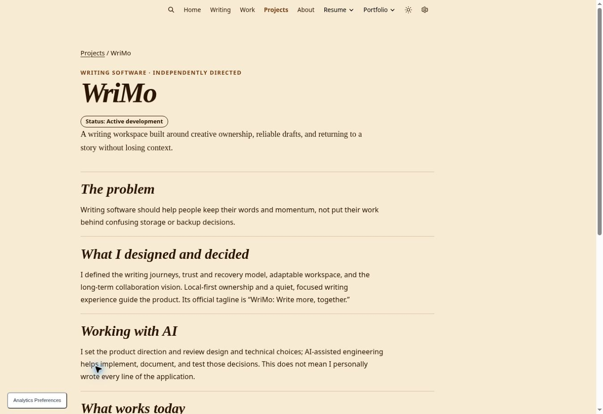
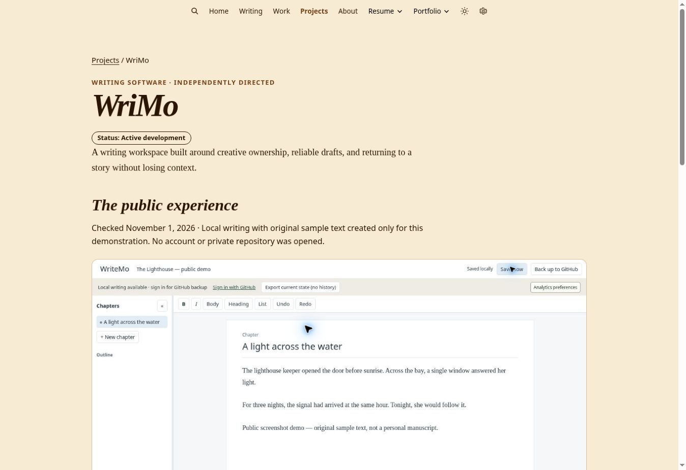

# Projects screenshot evidence — November 1, 2026

Issue #73. Owner visual/editorial approval is pending. Do not auto-merge or deploy.
Branch starts at current main `d48556b` including the merged Projects naming change (#77).
Routes and the professional portfolio remain unchanged.

## Capture and privacy

Five authentic public Chrome viewport captures, November 1, 2026 (America/New_York).
No sign-in, private repository, analytics dashboard, user records or unpublished build
was opened. WriMo uses an original fictional sample created for this capture and
explicitly labeled as a public demo. No sensitive information required redaction.
These are desktop captures, not mobile screenshots or device mockups.

Original browser JPEGs total about 388 KiB, each below 115 KB. Lossless WebP conversion
was evaluated but increased sizes; retained the smaller original JPEG bytes without
further lossy compression. No EXIF data. Dimensions are retained so interface text
remains readable at full size. No browser chrome, cropping or synthetic UI.
Exact dimensions, bytes, SHA-256 hashes, alt text, captions and source URLs are in
[`project-screenshot-inventory.json`](project-screenshot-inventory.json).

| Asset (under `assets/images/projects/`) | Source / demonstrated state |
| --- | --- |
| `wrimo-desktop-2026-11-01.jpg` | https://wrimo.app/ — named chapter, original demo manuscript, local-save status |
| `listening-room-desktop-2026-11-01.jpg` | https://listeningroom.app/listening-room/#/artist/edco26%3A2026-11-06%3Asloth?day=2026-11-06 — Friday lineup and Sloth artist panel |
| `listening-room-tracks-2026-11-01.jpg` | https://listeningroom.app/listening-room/#/listen?day=2026-11-06&tq=Sloth — three search results and outbound service links |
| `vamo-pr-desktop-2026-11-01.jpg` | https://vamopr.com/ — homepage and navigation |
| `vamo-pr-projects-2026-11-01.jpg` | https://vamopr.com/#projects-heading — project story/product navigation |

## Claims and rights

- WriMo: local creation, editing, chapter naming and saving exercised. No GitHub
  authentication, backup, recovery, persistent reopen, offline startup or collaboration
  verification is implied. Current UI says WriteMo; case-study product name is WriMo.
- Listening Room: live artist selection and track search exercised. YouTube/Spotify
  links visible; playback not tested. Poster-time warning retained. Own event playlist
  explicitly unavailable. Source `johnapaz/edc-listening-room` main at `178042b` and
  `listening-room/README.md` corroborate the public artist/track interface, not a
  Companion launch. Public UI is the primary capture evidence.
- Event Day Companion: https://listeningroom.app/companion/ returned “Nothing here.”
  https://vamopr.com/projects/event-day-companion/ labels the public product link
  pending verification and the product in development. No working public product
  screen verified; no screenshot substituted from Vamo, Listening Room or a review
  build. Do not publish its existing review SVG as authentic current release evidence.
- Vamo: directory and stories verified; visible contact form does not prove delivery.
  Its earlier map-first Companion wording remains visible in the captured source,
  and captions distinguish it from the newer stage/schedule direction.
- John retains ownership of original product/site work and this fictional sample.
  Music artwork, artist names, YouTube/Spotify marks and EDC/Insomniac marks retain
  their respective rights. Screenshots document the interface; they do not grant a
  separate license to extract artwork or imply endorsement. Preserve artwork credits
  and the unofficial-project disclosure. Source notices:
  https://listeningroom.app/about/credits/ and the source repository's
  `THIRD_PARTY_NOTICES.md`. Owner review includes selection and rights context.

## Presentation and QA

The shared detail layout adds static linked figures, descriptive alt text, captions,
source dates and an explicit availability message when evidence is absent. Images
scale to container width with their original aspect ratio. Full-size links remain
keyboard accessible without JavaScript, a lightbox or hover. Focus outlines are
explicit. No motion or new JavaScript is introduced. Homepage layout, professional
portfolio, writing, talks and Code & Projects are untouched.

Local `npm test`, protected dashboard build, JS syntax and `git diff --check` passed.
Ruby/Bundler are absent in this executor; the existing PR CI must run the frozen
Jekyll staging/production builds and generated-site checks. Do not interpret local
source inspection as a rendered Jekyll build.

## Built-page inspection

[CI run 41370102224](https://github.com/johnapaz/johnapaz.github.io/actions/runs/41370102224)
passed both staging and production builds/checkers. Downloaded the `staging-site`
artifact (ID 13109111781) and inspected its pages through the local preview.
Artifact `build-info.json` records PR merge-test SHA
`77a943afcaa5ab6f6c5fd4ffb6aab23b4e8460d0`, which includes implementation head
`06093c3e50a52b1cbf7f3c0707dc41f6c815379a`. Re-running the generated-site checker
passed 36 HTML pages and 1,123 internal links/assets/anchors.

Opened the built homepage, directory and all four case studies in Chrome. Inspected
WriMo in Light, Dark and Darker: images retain original colors, captions remain
readable, and full-size links work. Keyboard Tab reached the source link with a
3px solid focus outline. Desktop page had no horizontal overflow; the WriMo image
loaded at its expected 1363×936 natural dimensions. Gallery animation is `none`.
This does not replace actual mobile or reduced-motion preference testing.

Before/after references are desktop screenshots, not product-source assets:

| Before (live main) | After (CI-built preview) |
| --- | --- |
|  |  |

## Remaining acceptance gaps

- Mobile captures and actual mobile/reduced-motion visual inspection:
  the connected browser has no supported viewport/device-emulation API. Browser
  shortcuts did not enable emulation. No cropped desktop image is labeled mobile.
- Working public Companion screen requires product publication or a verified public
  URL from its release owner. No credentials requested or unpublished features used.
- Owner visual/editorial approval remains required. Keep #73 open until the remaining
  acceptance work and approval are recorded.

## Reuse by Vamo

Use this exact asset set and JSON inventory in `johnapaz/vamopr.com`; copy rather
than hotlink, preserving filenames, capture dates, qualifications and credits.
Suggested replacements: WriMo editor for its review image; Listening Room lineup
and Tracks search for its review images. Vamo's own homepage images are suitable
for cross-project documentation, not as Companion product screenshots. Companion
stays without product imagery until public evidence exists. [Vamo handoff issue #37](https://github.com/johnapaz/vamopr.com/issues/37) links
the focused johnapaz.com PR and asset directory; it does not authorize publication
or make changes to Vamo source. Recheck public screens before a later publication.
